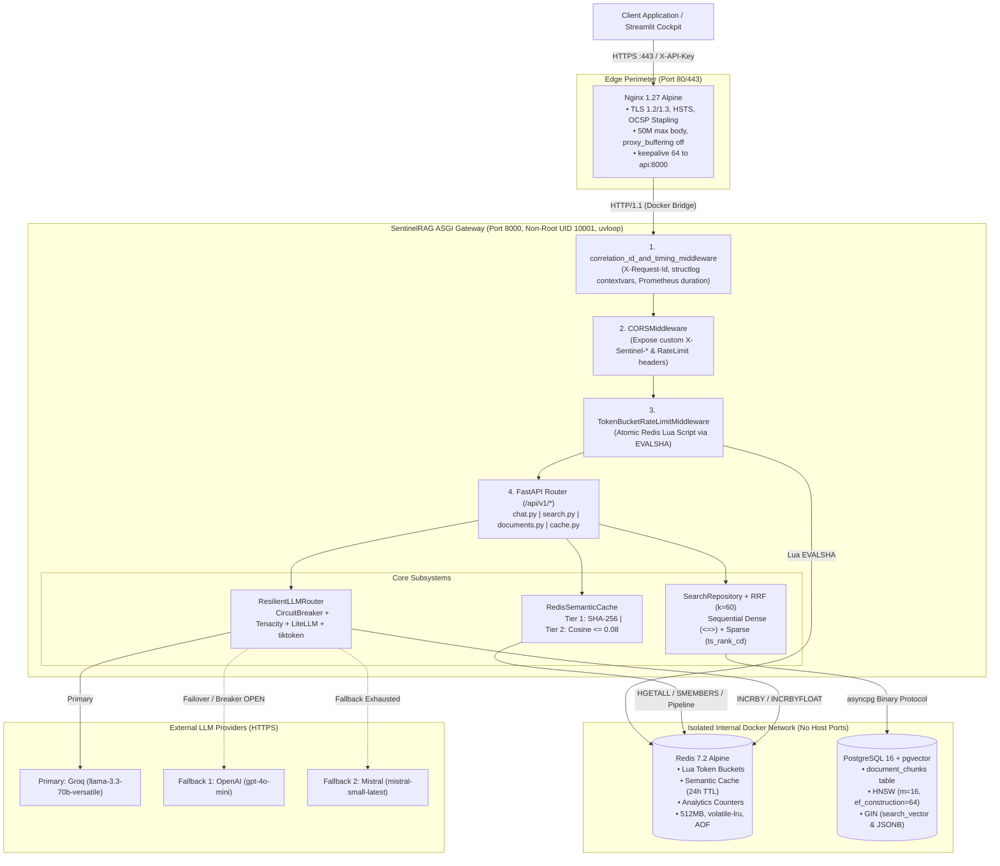

# 02. Project Architecture & Service Contracts

This document maps SentinelRAG's verified system topology, middleware execution order, layered module boundaries, inter-service failure behavior, and RFC 7807 error contracts.

---

## 1. System Topology & Trust Zones

SentinelRAG separates external untrusted ingress, the stateless ASGI gateway, internal persistence engines (unexposed to the public internet), and outbound LLM providers:



---

## 2. Verified ASGI Middleware Execution Order

> [!IMPORTANT]
> Earlier documentation (`PART1` and `interview_mastery/01`) stated that the rate limiter runs before the correlation middleware. Inspecting `app/main.py` proves the reverse—and explains why the rate limiter can read `request.state.request_id`!

In Starlette/FastAPI, each call to `app.add_middleware(...)` or `@app.middleware("http")` wraps the existing ASGI stack from the **outside**. Therefore, **the last middleware registered executes FIRST on incoming requests**.

In `app/main.py` (lines 579–614 of [supplementary.md](file:///c:/Users/kiran/Desktop/notes/archive/supplementary.md)):
1. Registered 1st: `app.add_middleware(TokenBucketRateLimitMiddleware, ...)` $\rightarrow$ **Innermost (runs 3rd)**
2. Registered 2nd: `app.add_middleware(CORSMiddleware, ...)` $\rightarrow$ **Middle (runs 2nd)**
3. Registered 3rd: `@app.middleware("http") correlation_id_and_timing_middleware` $\rightarrow$ **Outermost (runs 1st)**

**Why this actual runtime order is strictly better:**
1. Every incoming request (even one rejected with `HTTP 429` by the rate limiter!) receives an `X-Request-Id` first (`request.state.request_id`), clears stale `structlog` `contextvars`, binds `request_id`/`route`/`method`, and has its latency measured in `HTTP_REQUEST_DURATION_SECONDS`.
2. `TokenBucketRateLimitMiddleware` reads `getattr(request.state, "request_id", None)` and embeds that exact `request_id` inside the `429` RFC 7807 JSON body and `X-Request-Id` header.
3. Because `CORSMiddleware` wraps outside `TokenBucketRateLimitMiddleware`, even `HTTP 429` responses get proper CORS headers (`Access-Control-Allow-Origin` and `expose_headers` for `Retry-After` / `X-RateLimit-*`).

---

## 3. Acyclic 5-Tier Module Dependency Architecture

SentinelRAG enforces a strict downward-only import graph to avoid circular imports during startup:

```
Tier 5: Entrypoint         app/main.py
                              │
Tier 4: API & Middleware   app/api/v1/{__init__,chat,search,documents,cache}.py
                           app/core/rate_limiter.py, app/schemas/*.py
                              │
Tier 3: Domain Services    app/services/{cache,rrf,resilience,router,token_analytics}.py
                              │
Tier 2: Data & Models      app/db/base.py, app/db/session.py
                           app/models/document.py, app/repositories/search.py
                              │
Tier 1: Core Primitives    app/core/{config,logging,exceptions,database,redis,circuit_breaker,telemetry}.py
```

*Note on a minor coupling quirk in existing code:* `app/core/database.py` (Tier 1) imports `engine` and `async_session_factory` from `app/db/session.py` (Tier 2), while `db/session.py` only imports `core/config` and `core/logging`. In a strict refactor, the engine and session factory would live directly in `core/database.py` (as shown in `001curriculum` Day 1) so Tier 1 never imports from Tier 2.

---

## 4. Service Interaction & Failure Boundary Contracts

How each subsystem communicates and behaves when its downstream target fails:

| Caller | Target | Transport / Driver | Timeout / Pool Config | Failure Policy (Verified in Code) |
| :--- | :--- | :--- | :--- | :--- |
| **Nginx** | **FastAPI (`api:8000`)** | HTTP/1.1 (`keepalive 64`) | `connect 10s`, `read/send 300s`, `max_fails=3`, `fail_timeout=10s` | Returns `502`/`504` if backend unreachable. |
| **Rate Limiter** | **Redis 7.2** | `redis.asyncio` (`hiredis` TCP) | `REDIS_POOL_SIZE=50`, `socket_timeout=0.5s` | **Fail-Open:** Logs `rate_limit_redis_evaluation_error`, returns `allowed=True` so Redis blips do not cause total downtime. |
| **Semantic Cache** | **Redis 7.2** | `redis.asyncio` (`decode_responses=True`) | Same Redis pool (`0.5s` socket timeout) | **Fail-Open:** Exact/semantic lookup errors return synthetic `CACHE_MISS`; cache write errors log warning and still return LLM response. |
| **Token Analytics** | **Redis 7.2** | `redis.asyncio` Pipeline (`INCRBY` / `INCRBYFLOAT`) | Same Redis pool | **Graceful Degradation:** Falls back to process-local in-memory accumulators (`_in_memory_*`) on Redis failure. |
| **Repositories / Ingest** | **PostgreSQL 16** | `SQLAlchemy 2.0` + `asyncpg` binary TCP | `pool_size=20`, `max_overflow=10`, `pool_recycle=300s`, `pool_pre_ping=True`, `pool_timeout=30s` | **Ingestion/Search endpoints:** session rolls back and raises 500. **Chat endpoint (`use_retrieval=True`):** catches retrieval error (`hybrid_retrieval_degraded_continuing_unaugmented`) and continues to LLM unaugmented. **`/healthz`:** flips from `200` to `503`. |
| **LLM Router** | **Groq / OpenAI / Mistral** | `litellm.acompletion` (`httpx` async) | `timeout=4.0s` (`CIRCUIT_BREAKER_TIMEOUT_SECONDS`) | **Cascading Failover:** Tenacity retries transient errors (3x primary, 2x fallback), trips `CircuitBreaker` after 5 failures, cascades Groq $\to$ OpenAI $\to$ Mistral. |

---

## 5. Exception Contract (RFC 7807 Problem Details)

SentinelRAG standardizes error envelopes in `app/core/exceptions.py` using **IETF RFC 7807** (`Content-Type: application/problem+json`):

```json
{
  "type": "https://sentinelrag.io/errors/rate-limit-exceeded",
  "title": "Too Many Requests",
  "status": 429,
  "detail": "Rate limit quota exceeded (100 req/min). Retry after 1s.",
  "instance": "/api/v1/chat/completions",
  "request_id": "req_a1b2c3d4e5f67890",
  "invalid_params": []
}
```

### Verified Exception Classes vs. Actual Middleware Behavior
- `app/core/exceptions.py` defines:
  - `ProblemDetailException(status, title, detail, type_uri, invalid_params)`
  - `RateLimitExceededException` (`429`, sets `Retry-After`)
  - `DatabaseConnectionException` (`503`)
  - `problem_detail_exception_handler` registered in `app/main.py`.
- **Nuance to know:** `TokenBucketRateLimitMiddleware` constructs and returns the RFC 7807 `JSONResponse` directly (rather than raising `RateLimitExceededException`) because FastAPI exception handlers registered on the app do not cleanly intercept exceptions raised *inside* Starlette `BaseHTTPMiddleware` before entering the router exception middleware.
- **Security Posture:** Internal stack traces are logged via `structlog` with `request_id` and not leaked inside `ProblemDetailException` responses; Swagger `/docs` and `/redoc` are disabled automatically when `settings.ENVIRONMENT == "production"`.

---

## 6. Component Boundary Summary (What Owns What)

- **Middleware owns cross-cutting edge policy:** Request ID minting, timing, Prometheus HTTP duration recording, CORS, and quota enforcement happen *before* route handlers allocate `AsyncSession` connections or deserialize large vector arrays.
- **Routes (`app/api/v1/*.py`) own orchestration & DTO translation only:** They validate Pydantic schemas, inject dependencies via `Depends()`, coordinate service/repository calls, and build response payloads. They contain zero raw SQL or Lua logic.
- **Services (`app/services/*.py`) own pure/domain logic:** Cache serialization/cosine math, RRF math, Tenacity transient error classification, LiteLLM fallback selection, and `tiktoken` pricing calculations.
- **Repositories (`app/repositories/*.py`) own SQL queries:** Encapsulates `pgvector` `<=>` and PostgreSQL `ts_rank_cd` queries behind `DenseCandidate` and `SparseCandidate` dataclasses.

---
**Next:** [03-end-to-end-workflow.md](file:///c:/Users/kiran/Desktop/notes/interview-preparation/03-end-to-end-workflow.md)

