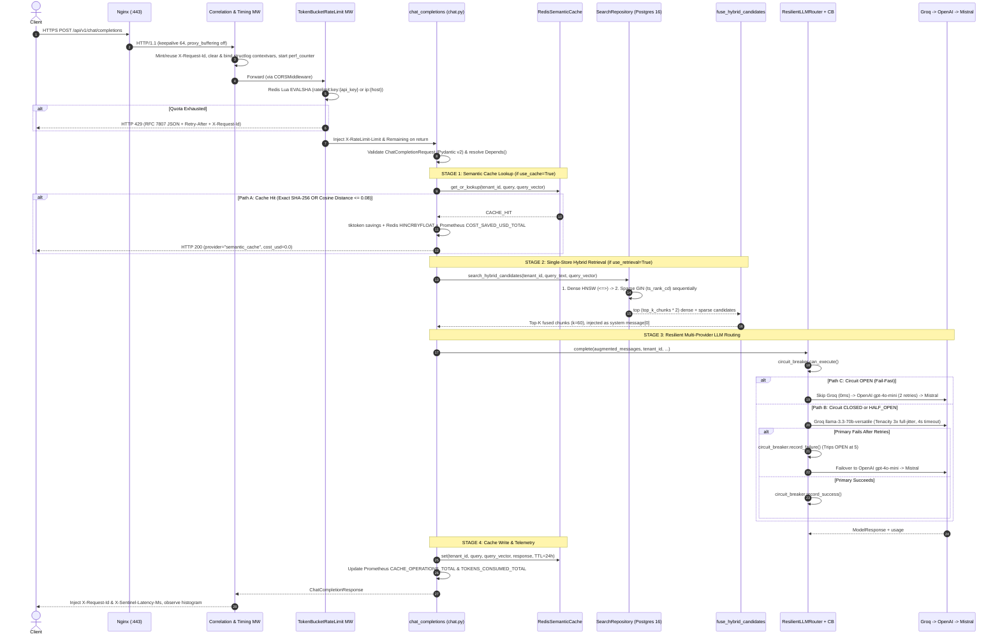

# 03. End-to-End Request Workflows

This guide traces the complete runtime path of requests through SentinelRAG—starting with the flagship `POST /api/v1/chat/completions` pipeline across its three execution branches, followed by the supporting ingestion, search, cache-management, and diagnostic routes.

---

## 1. Flagship Pipeline: `POST /api/v1/chat/completions`

### Visual Execution Flow (3 Branches)

---

## 2. Step-by-Step Request Lifecycle (Ingress to Egress)

### Phase 1: Network & Edge Perimeter (Nginx)
1. **TLS Termination & Socket Accept:** Client opens a TCP connection to port `443`. Linux `epoll` notifies Nginx, which terminates TLS 1.2/1.3 using ECDHE/AEAD ciphers (`ssl_session_tickets off` preserves forward secrecy; OCSP stapling avoids external CA lookup latency).
2. **Security & Streaming Directives:** Nginx enforces `client_max_body_size 50M`, adds HSTS/CSP-hardening headers (`X-Frame-Options: DENY`, `X-Content-Type-Options: nosniff`), disables `proxy_buffering` and `proxy_cache` (so future SSE streaming flushes immediately), and forwards over Docker network `sentinel_prod_network` via persistent `keepalive 64` HTTP/1.1 sockets to `api:8000`.

### Phase 2: ASGI Middleware Pipeline (Verified Runtime Order)
3. **Uvicorn + `uvloop` Dispatch:** `uvicorn app.main:app --loop uvloop` receives the HTTP frame via `libuv`'s `epoll` loop and builds the ASGI `(scope, receive, send)` invocation.
4. **Correlation & Timing Middleware (`correlation_id_and_timing_middleware` in `app/main.py`):**
   - Runs **first** (outermost wrapper).
   - Reads incoming `X-Request-Id` or mints `f"req_{uuid.uuid4().hex[:16]}"`, storing it on `request.state.request_id`.
   - Calls `structlog.contextvars.clear_contextvars()` (preventing coroutine context leakage across reused tasks) and binds `request_id`, `route`, and `method`.
   - Starts monotonic timer `time.perf_counter()`.
5. **CORS Middleware (`CORSMiddleware`):**
   - Runs **second**, ensuring preflight `OPTIONS` requests and exposed custom headers (`X-Sentinel-Cache`, `X-Sentinel-Latency-Ms`, `X-Sentinel-Provider`, `X-Request-Id`, `X-RateLimit-Limit`, `X-RateLimit-Remaining`, `Retry-After`) are applied even if the rate limiter short-circuits.
6. **Token-Bucket Rate Limiter (`TokenBucketRateLimitMiddleware` in `app/core/rate_limiter.py`):**
   - Runs **third** (innermost middleware before route matching).
   - Skips exempt diagnostic/docs paths (`/healthz`, `/`, `/docs`, `/redoc`, `/openapi.json`). Note: `/metrics` is *not* in `EXEMPT_PATHS`.
   - Identifies the caller via `key:{X-API-Key}` (falling back to `ip:{client.host}`).
   - Calls `TokenBucketLimiter.check()` with `capacity=100`, `refill_rate_per_sec=10`, `requested=1` (from `settings` in `app/main.py`).
   - Executes `TOKEN_BUCKET_LUA_SCRIPT` via `EVALSHA` (auto-recovering with `EVAL` on `NoScriptError`). Uses `redis.call('TIME')` inside Redis to refill fractional tokens lazily and persist state with an auto-expiring TTL.
   - **Short-circuit branch:** If `allowed == False`, returns `HTTP 429` with RFC 7807 JSON (`Content-Type: application/problem+json`), `Retry-After`, `X-RateLimit-Limit`, `X-RateLimit-Remaining: 0`, and `X-Request-Id`.
   - **Fail-open safety:** If Redis raises an exception or is uninitialized, logs `rate_limit_redis_evaluation_error` and lets the request pass.

### Phase 3: Validation, Dependency Injection & Core Stages
7. **Pydantic v2 Validation & DI Resolution:**
   - FastAPI parses `ChatCompletionRequest` (`messages`, `tenant_id`, optional `model`, `temperature`, `max_tokens`, `use_cache=True`, `use_retrieval=False`, `query_vector=None`, `top_k_chunks=3`).
   - Resolves `Depends` DAG: `get_async_session` (yields SQLAlchemy `AsyncSession` with rollback-on-error + `close()`), `get_redis_client` (returns pooled `aioredis.Redis`), and `get_llm_router` (returns singleton `ResilientLLMRouter` preserving in-memory `CircuitBreaker` state).
8. **Stage 1 — Two-Tier Semantic Cache (`app/services/cache.py`):**
   - Runs if `payload.use_cache` is `True` and a `user` message exists (`query_text = user_messages[-1].content`).
   - **Tier 1 (Exact Match):** Normalizes `query.strip().lower()`, computes `SHA-256`, runs `HGETALL cache:{tenant_id}:{query_hash}`. Returns immediately on hit (`similarity=1.0, distance=0.0`).
   - **Tier 2 (Semantic Vector Scan):** Runs if Tier 1 misses. Reads `SMEMBERS cache:{tenant_id}:keys`, pipelines `HGETALL` for all tenant keys, unpacks base64 IEEE 754 floats via `struct.unpack`, computes cosine similarity, lazily `SREM`s any expired ghost keys, and checks `best_distance <= 0.08` (`similarity >= 0.92`).
   - **Path A Exit (Cache Hit):** Increments Prometheus `CACHE_OPERATIONS_TOTAL(result="hit")`, counts saved tokens via `tiktoken` (baseline `gpt-4o-mini`), atomically increments Redis spend-saved keys (`record_cache_hit_savings`), increments `COST_SAVED_USD_TOTAL`, and returns `ChatCompletionResponse` with `model="sentinel-semantic-cache"`, `provider="semantic_cache"`, `cost_usd=0.0`. Skips Postgres and LLM completely.
9. **Stage 2 — Single-Store Hybrid Retrieval (`app/repositories/search.py` + `app/services/rrf.py`):**
   - Runs if `payload.use_retrieval` is `True`.
   - Instantiates `SearchRepository(session)` and calls `search_hybrid_candidates` with `dense_limit = top_k_chunks * 2` and `sparse_limit = top_k_chunks * 2`.
   - **Sequential Execution:** Runs `search_dense` (`embedding <=> :query_vector`, HNSW cosine index) followed by `search_sparse` (`search_vector @@ websearch_to_tsquery('english', ...)` ordered by `ts_rank_cd`, GIN index) **sequentially** on the single `AsyncSession` to prevent `asyncpg.InterfaceError` on the single TCP socket.
   - **RRF Fusion:** `fuse_hybrid_candidates(..., k=60, top_k=payload.top_k_chunks)` combines dense and sparse ranks via $\sum \frac{1}{60 + r_m(d)}$, tie-breaks by `dense_score` then `sparse_score`, and formats top chunks into a `system` message inserted at index `0` of `augmented_messages`.
   - **Graceful Degradation:** Wrapped in `try/except`; if PostgreSQL fails during search, logs `hybrid_retrieval_degraded_continuing_unaugmented` and proceeds to the LLM without retrieved context rather than failing the user request.
10. **Stage 3 — Resilient Multi-Provider Routing (`app/services/router.py`):**
    - Checks `await circuit_breaker.can_execute()` (`asyncio.Lock`-guarded).
    - **Path C (Circuit `OPEN`):** Bypasses primary Groq in `0ms` and immediately invokes `_execute_fallback` targeting `openai/gpt-4o-mini` (up to `max_attempts=2` with Tenacity full jitter). If fallback also fails, falls back once to tertiary `mistral/mistral-small-latest`.
    - **Path B (Circuit `CLOSED` or `HALF_OPEN`):** Calls `execute_with_resilience(litellm.acompletion, model="groq/llama-3.3-70b-versatile", timeout=4.0, max_attempts=3, multiplier=0.5, max_wait=4.0)`.
      - Only transient exceptions (`429`, `502`, `503`, `504`, `Timeout`, `APIConnectionError`) trigger Tenacity retries (`Uniform(0, min(max_wait, 0.5 * 2^attempt))`); fatal `400/401/403` errors fail immediately.
      - On success: calls `circuit_breaker.record_success()` (resets failures, closes `HALF_OPEN` $\to$ `CLOSED`).
      - On exhaustion: calls `circuit_breaker.record_failure()` (trips `CLOSED` $\to$ `OPEN` at `5` consecutive failures, or immediately re-trips `HALF_OPEN` $\to$ `OPEN`), then executes `_execute_fallback`.
    - Computes exact token counts (provider `usage` with `tiktoken` fallback) and USD cost, recording spend to Redis via `record_llm_execution`.
11. **Stage 4 — Cache Write & Telemetry Response:**
    - If `use_cache` is `True` and `router_result.content` is non-empty, writes the query, base64-packed `query_vector`, response, and metadata to Redis with a `86400s` (24h) TTL (caught in `try/except` so cache-write failure never breaks the HTTP response).
    - Increments Prometheus `CACHE_OPERATIONS_TOTAL(result="miss")` and `TOKENS_CONSUMED_TOTAL`.
    - Returns `ChatCompletionResponse`. On unwind, `TokenBucketRateLimitMiddleware` attaches `X-RateLimit-Limit`/`Remaining`, `CORSMiddleware` attaches CORS headers, and `correlation_id_and_timing_middleware` attaches `X-Request-Id` and `X-Sentinel-Latency-Ms` and observes `HTTP_REQUEST_DURATION_SECONDS`.

---

## 3. Code-Level Observations & Edge Cases in the Workflow

Pointing these out in a design review or interview shows you actually read and understand the implementation:

1. **Missing `query_vector` Edge Case in `chat.py`:**
   - Look at `chat.py` line 4609 and 4674: if a client sends `use_cache=True, use_retrieval=True` **without** `query_vector`:
     - In `cache.py` Stage 2, if `smembers` is non-empty, `compute_cosine_similarity(None, cached_vec)` throws a `TypeError` (caught and logged as `semantic_cache_lookup_failed`, returning `CACHE_MISS`).
     - In `chat.py` Stage 2, `query_vector=payload.query_vector or [0.0] * 1536` runs dense search with an all-zero dummy vector!
     - In `chat.py` Stage 4, `cache_service.set(..., query_vector=None)` triggers `TypeError` in `struct.pack`, caught by `cache_write_failed_continuing`.
   - **Production Fix:** Make `chat_completions` embed `query_text` via `litellm.aembedding()` whenever `query_vector is None` and Tier 1 exact hash misses (or `use_retrieval=True`).
2. **Inline vs. Background Cache Persistence:**
   - Currently `await cache_service.set(...)` blocks response return by 1 Redis pipeline RTT. Using FastAPI `BackgroundTasks.add_task(...)` removes that RTT from user latency.
3. **Middleware Header Detail:**
   - Notice `chat.py` sets `telemetry.cache_hit` in the JSON body; `X-Sentinel-Cache` and `X-Sentinel-Provider` are listed in `CORSMiddleware.expose_headers` in `main.py`, though `chat.py` doesn't explicitly set those HTTP headers on the `Response` object today (another crisp codebase-level observation!).

---

## 4. Secondary Endpoint Workflows

| Endpoint | Module | Flow Summary | Key Detail |
| :--- | :--- | :--- | :--- |
| **`POST /api/v1/documents/batch`** | `app/api/v1/documents.py` | Validates up to `1000` chunks (each `1536`-dim) $\to$ bulk `insert(DocumentChunk).returning(DocumentChunk.id)` $\to$ `await session.commit()` $\to$ returns `201 Created` with UUID list. | Uses PostgreSQL dialect `insert` for `RETURNING`; `search_vector` is omitted because Postgres computes `GENERATED ALWAYS AS ... STORED`. |
| **`POST /api/v1/search/hybrid`** | `app/api/v1/search.py` | Validates `query` + `1536`-dim `query_vector` $\to$ `SearchRepository.search_hybrid_candidates` (default `50` dense + `50` sparse) $\to$ `fuse_hybrid_candidates` (`k=60, top_k=10`). | Rejects mismatched vector dimensions at Pydantic boundary (`422`) before touching the Postgres pool. |
| **`POST /api/v1/cache/evaluate`** | `app/api/v1/cache.py` | Calls `RedisSemanticCache.get_or_lookup`; if `CACHE_MISS` and `store_if_miss=True` + `prompt_response` provided, writes entry to Redis and returns `stored=True` + latency breakdown. | Built specifically for cache threshold tuning and latency benchmarking. |
| **`POST /api/v1/cache/set`** | `app/api/v1/cache.py` | Directly populates a tenant cache key with custom or default (`86400s`) TTL (`201 Created`). | Useful for pre-warming FAQ caches after document updates. |
| **`POST /api/v1/cache/invalidate`** | `app/api/v1/cache.py` | Reads `SMEMBERS cache:{tenant_id}:keys` $\to$ opens transactional Redis pipeline to `DELETE` all tenant entry keys + index set $\to$ returns `keys_evicted`. | Prevents stale answers after a tenant updates its knowledge base. |
| **`GET /healthz`** | `app/main.py` | Pings PostgreSQL (`SELECT 1`) and Redis (`PING`), measures round-trip ms for each. | Returns `200` (`healthy`) if both up, `503` (`degraded`) if either down—so orchestrators unroute traffic without assuming app crash. |
| **`GET /metrics`** | `app/main.py` | Calls `prometheus_client.generate_latest()`. | Returns OpenMetrics plaintext (`text/plain; version=0.0.4`) for Prometheus pull scraping. |

---
**Next:** [04-core-concepts.md](file:///c:/Users/kiran/Desktop/notes/interview-preparation/04-core-concepts.md)

