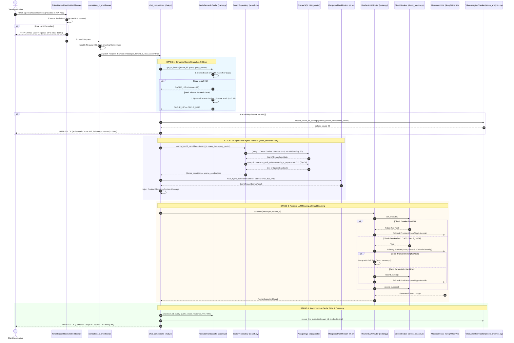

# SentinelRAG: Architecture & Request Execution Flows

> **Target Audience:** Python Backend Developers (2–4 Years Experience) preparing for Senior / Mid-Senior Technical Interviews.  
> **Workspace Root:** [c:/Users/kiran/Desktop/sentinel-rag](file:///c:/Users/kiran/Desktop/sentinel-rag)

---

## 1. Architectural File & Function Reference Table

The following master reference table maps every architectural component in SentinelRAG, linking exact file paths, symbols, callers, and dependencies:

| Feature / Responsibility | File Path | Important Class / Function | Purpose | Called By | Calls / Depends On |
| :--- | :--- | :--- | :--- | :--- | :--- |
| **App Lifecycle & Health** | [app/main.py](file:///c:/Users/kiran/Desktop/sentinel-rag/app/main.py#L25-L60) | `lifespan(app: FastAPI)` | Initializes logging, warms DB/Redis pools, runs pre-flight pings, tears down on SIGTERM. | Uvicorn ASGI Server | [db_manager.initialize](file:///c:/Users/kiran/Desktop/sentinel-rag/app/core/database.py#L24), [redis_manager.initialize](file:///c:/Users/kiran/Desktop/sentinel-rag/app/core/redis.py#L16) |
| **Distributed Rate Limiting** | [app/core/rate_limiter.py](file:///c:/Users/kiran/Desktop/sentinel-rag/app/core/rate_limiter.py#L171-L268) | `TokenBucketRateLimitMiddleware` | Enforces tenant/IP token bucket quotas via atomic Redis Lua script; returns RFC 7807 429. | FastAPI Middleware Stack | [TokenBucketLimiter.check](file:///c:/Users/kiran/Desktop/sentinel-rag/app/core/rate_limiter.py#L107), Redis `evalsha` |
| **Correlation & Latency** | [app/main.py](file:///c:/Users/kiran/Desktop/sentinel-rag/app/main.py#L105-L141) | `correlation_id_and_timing_middleware` | Generates `X-Request-Id`, binds to `structlog` ContextVars, records Prometheus latency histogram. | FastAPI Middleware Stack | `structlog.contextvars`, [HTTP_REQUEST_DURATION_SECONDS](file:///c:/Users/kiran/Desktop/sentinel-rag/app/core/telemetry.py#L14) |
| **Chat Orchestration** | [app/api/v1/chat.py](file:///c:/Users/kiran/Desktop/sentinel-rag/app/api/v1/chat.py#L60-L330) | `chat_completions(...)` | Coordinates Cache lookup -> Hybrid Search -> Resilient LLM Router -> Telemetry write. | HTTP Clients (`POST /api/v1/chat/completions`) | [RedisSemanticCache](file:///c:/Users/kiran/Desktop/sentinel-rag/app/services/cache.py), [SearchRepository](file:///c:/Users/kiran/Desktop/sentinel-rag/app/repositories/search.py), [ResilientLLMRouter](file:///c:/Users/kiran/Desktop/sentinel-rag/app/services/router.py) |
| **Semantic Cache** | [app/services/cache.py](file:///c:/Users/kiran/Desktop/sentinel-rag/app/services/cache.py#L79-L272) | `RedisSemanticCache.get_or_lookup(...)` | Evaluates exact SHA-256 hash fast-path; falls back to cosine distance scan over tenant vectors. | [chat_completions](file:///c:/Users/kiran/Desktop/sentinel-rag/app/api/v1/chat.py#L88), [cache router](file:///c:/Users/kiran/Desktop/sentinel-rag/app/api/v1/cache.py#L44) | Redis `hgetall`, `smembers`, `pipeline`, [compute_cosine_similarity](file:///c:/Users/kiran/Desktop/sentinel-rag/app/services/cache.py#L55) |
| **Hybrid Search Repo** | [app/repositories/search.py](file:///c:/Users/kiran/Desktop/sentinel-rag/app/repositories/search.py#L132-L151) | `SearchRepository.search_hybrid_candidates` | Queries PostgreSQL 16 sequentially for dense cosine candidates (`<=>`) and sparse lexical candidates (`ts_rank_cd`). | [chat_completions](file:///c:/Users/kiran/Desktop/sentinel-rag/app/api/v1/chat.py#L183), [hybrid_search](file:///c:/Users/kiran/Desktop/sentinel-rag/app/api/v1/search.py#L46) | SQLAlchemy `select`, `AsyncSession.execute`, `pgvector` HNSW, GIN `search_vector` |
| **Reciprocal Rank Fusion** | [app/services/rrf.py](file:///c:/Users/kiran/Desktop/sentinel-rag/app/services/rrf.py#L69-L141) | `fuse_hybrid_candidates(...)` | Mathematical rank fusion ($k=60$) combining disparate vector and lexical rankings into a single sorted list. | [chat_completions](file:///c:/Users/kiran/Desktop/sentinel-rag/app/api/v1/chat.py#L191), [hybrid_search](file:///c:/Users/kiran/Desktop/sentinel-rag/app/api/v1/search.py#L54) | Pure Python dataclass structures, no I/O |
| **Resilient LLM Routing** | [app/services/router.py](file:///c:/Users/kiran/Desktop/sentinel-rag/app/services/router.py#L75-L203) | `ResilientLLMRouter.complete(...)` | Evaluates Circuit Breaker; routes to Groq with Tenacity retries; fails over to OpenAI upon error. | [chat_completions](file:///c:/Users/kiran/Desktop/sentinel-rag/app/api/v1/chat.py#L235) | [CircuitBreaker](file:///c:/Users/kiran/Desktop/sentinel-rag/app/core/circuit_breaker.py), [execute_with_resilience](file:///c:/Users/kiran/Desktop/sentinel-rag/app/services/resilience.py), `litellm.acompletion` |
| **Circuit Breaker** | [app/core/circuit_breaker.py](file:///c:/Users/kiran/Desktop/sentinel-rag/app/core/circuit_breaker.py#L41-L184) | `CircuitBreaker` | State machine (`CLOSED`, `OPEN`, `HALF_OPEN`) preventing cascading latency during upstream outages. | [ResilientLLMRouter](file:///c:/Users/kiran/Desktop/sentinel-rag/app/services/router.py#L96) | `asyncio.Lock`, internal timestamps |
| **Token & Spend Analytics** | [app/services/token_analytics.py](file:///c:/Users/kiran/Desktop/sentinel-rag/app/services/token_analytics.py#L91-L226) | `TokenAnalyticsTracker` | Computes BPE tokens via `tiktoken`, tracks per-request cost and cumulative dollars saved in Redis. | [chat_completions](file:///c:/Users/kiran/Desktop/sentinel-rag/app/api/v1/chat.py#L109), [ResilientLLMRouter](file:///c:/Users/kiran/Desktop/sentinel-rag/app/services/router.py#L153) | `tiktoken.Encoding`, Redis pipeline `incrbyfloat` |
| **Batch Document Ingestion** | [app/api/v1/documents.py](file:///c:/Users/kiran/Desktop/sentinel-rag/app/api/v1/documents.py#L31-L74) | `batch_ingest_documents(...)` | Bulk-inserts document chunks, embeddings, and metadata in a single atomic SQL transaction. | HTTP Clients (`POST /api/v1/documents/batch`) | SQLAlchemy `insert(DocumentChunk).returning(...)`, `session.commit` |
| **RFC 7807 Exception Handler** | [app/core/exceptions.py](file:///c:/Users/kiran/Desktop/sentinel-rag/app/core/exceptions.py#L51-L82) | `problem_detail_exception_handler` | Traps domain exceptions and formats standardized `application/problem+json` payloads. | FastAPI Exception Pipeline | `JSONResponse`, `structlog.warning` |

---

## 2. Request Flow 1: Unified Chat Completion (`POST /api/v1/chat/completions`)

This is the primary enterprise pipeline in SentinelRAG. It orchestrates cache evaluation, hybrid retrieval, circuit-breaker routing, and cost telemetry.

### Mermaid Sequence Diagram


### Detailed Step-by-Step Execution Trace

1. **Trigger:** An external caller or frontend client makes an HTTP request:
   `POST /api/v1/chat/completions` with JSON payload conforming to [ChatCompletionRequest](file:///c:/Users/kiran/Desktop/sentinel-rag/app/schemas/chat.py#L35-L67).
2. **Rate Limiting Gate:**
   - **Entry:** [TokenBucketRateLimitMiddleware.dispatch](file:///c:/Users/kiran/Desktop/sentinel-rag/app/core/rate_limiter.py#L200-L268).
   - **Data Extracted:** Request header `X-API-Key` (e.g., `key:sk_live_12345`) or client IP (`ip:192.168.1.1`).
   - **Operation:** Calls [TokenBucketLimiter.check](file:///c:/Users/kiran/Desktop/sentinel-rag/app/core/rate_limiter.py#L107-L168). Loads the compiled Lua SHA into Redis.
   - **Lua Script Execution:** Checks token count in Redis hash `ratelimit:key:xxx`. Replenishes tokens using the Redis server monotonic clock: `tokens = min(capacity, tokens + delta * refill_rate)`.
   - **Failure Branch:** If tokens < 1, the middleware halts execution and returns an HTTP 429 JSON response formatted according to RFC 7807 with headers `X-RateLimit-Limit`, `X-RateLimit-Remaining: 0`, and `Retry-After: N`.
3. **Correlation & Telemetry Gate:**
   - **Entry:** [correlation_id_and_timing_middleware](file:///c:/Users/kiran/Desktop/sentinel-rag/app/main.py#L105-L141).
   - **Operation:** Reads `X-Request-Id` header or generates `req_<hex24>`. Binds `request_id`, `route`, and `method` to `structlog.contextvars`. Records `start_time = time.perf_counter()`.
4. **Endpoint Dispatch & Dependency Injection:**
   - **Entry:** [chat_completions](file:///c:/Users/kiran/Desktop/sentinel-rag/app/api/v1/chat.py#L60-L330).
   - **Injected Dependencies:**
     - `session: AsyncSession` via [get_async_session](file:///c:/Users/kiran/Desktop/sentinel-rag/app/db/session.py#L41-L56).
     - `redis: aioredis.Redis` via [get_redis_client](file:///c:/Users/kiran/Desktop/sentinel-rag/app/core/redis.py#L59-L64).
     - `router_service: ResilientLLMRouter` via [get_llm_router](file:///c:/Users/kiran/Desktop/sentinel-rag/app/services/router.py#L338-L343).
5. **Stage 1: Semantic & Exact Cache Lookup:**
   - **Condition:** Evaluated if `payload.use_cache == True` and a user query message exists.
   - **Execution:** Calls [cache_service.get_or_lookup](file:///c:/Users/kiran/Desktop/sentinel-rag/app/services/cache.py#L103-L272).
   - **Sub-step 1A (Fast-Path):** Computes `SHA-256(query.strip().lower())`. Performs `HGETALL cache:{tenant_id}:{hash}`. If present, returns exact hit in $< 2$ms.
   - **Sub-step 1B (Semantic Scan):** If hash misses, retrieves all cached key names for this tenant from `SMEMBERS cache:{tenant_id}:keys`. Executes a pipelined `HGETALL` across candidate hashes.
   - **Vector Math:** For each candidate, unpacks base64 IEEE 754 floats and computes cosine distance `1.0 - cosine_similarity(query_vector, cached_vector)`.
   - **Cache Hit Exit:** If the minimum distance $\le 0.08$ (default threshold):
     - Computes tokens saved via [count_messages_tokens](file:///c:/Users/kiran/Desktop/sentinel-rag/app/services/token_analytics.py#L68) and [count_text_tokens](file:///c:/Users/kiran/Desktop/sentinel-rag/app/services/token_analytics.py#L60).
     - Records saved dollars in Redis via [record_cache_hit_savings](file:///c:/Users/kiran/Desktop/sentinel-rag/app/services/token_analytics.py#L134) and increments `COST_SAVED_USD_TOTAL` Prometheus counter.
     - Immediately returns [ChatCompletionResponse](file:///c:/Users/kiran/Desktop/sentinel-rag/app/schemas/chat.py#L82) with `telemetry.cache_hit = True` and total latency $< 20$ms. Downstream retrieval and LLM routing are completely skipped.
6. **Stage 2: Single-Store Hybrid Retrieval (if Cache Missed):**
   - **Condition:** Evaluated if `payload.use_retrieval == True`.
   - **Execution:** Instantiates [SearchRepository(session)](file:///c:/Users/kiran/Desktop/sentinel-rag/app/repositories/search.py#L34). Calls `search_hybrid_candidates(...)`.
   - **Sequential Execution Rationale:** Runs dense search first, then sparse search sequentially on the `AsyncSession`. (Running them concurrently with `asyncio.gather` on the same SQLAlchemy session causes an `asyncpg.InterfaceError: another operation is in progress` because asyncpg connections are single-channel).
   - **Dense Query:** `select(DocumentChunk, embedding.cosine_distance(query_vector)).where(tenant_id == ...).order_by(distance.asc()).limit(50)`. Executes against PostgreSQL 16 HNSW index.
   - **Sparse Query:** `select(DocumentChunk, ts_rank_cd(search_vector, websearch_to_tsquery('english', query))).where(tenant_id == ..., search_vector @@ query).order_by(rank.desc()).limit(50)`. Executes against PostgreSQL GIN index.
   - **Fusion:** Passes both candidate lists to [fuse_hybrid_candidates](file:///c:/Users/kiran/Desktop/sentinel-rag/app/services/rrf.py#L69-L141). Computes RRF score for each unique chunk UUID: $\sum \frac{1}{60 + \text{rank}}$. Sorts descending and takes `top_k_chunks` (default: 5).
   - **Prompt Augmentation:** Formats the retrieved text snippets into an enterprise verification context block and prepends it to the messages list as a `system` instruction.
   - **Fallback on Error:** Wrapped in a `try...except Exception`. If the database search fails, a warning is logged and execution proceeds unaugmented rather than crashing the client request.
7. **Stage 3: Resilient LLM Routing:**
   - **Execution:** Calls [router_service.complete(...)](file:///c:/Users/kiran/Desktop/sentinel-rag/app/services/router.py#L75-L203).
   - **Circuit Breaker Check:** Calls [circuit_breaker.can_execute()](file:///c:/Users/kiran/Desktop/sentinel-rag/app/core/circuit_breaker.py#L85-L106).
   - **Fail-Fast Branch:** If circuit state is `OPEN`, immediately calls `_execute_fallback(...)` targeting OpenAI `gpt-4o-mini` with zero network delay wasted on Groq.
   - **Primary Execution Branch:** If circuit is `CLOSED` or `HALF_OPEN`, invokes `execute_with_resilience(litellm.acompletion, model="groq/llama-3.3-70b-versatile", ...)`:
     - Wrapped in Tenacity async retry engine: [create_resilient_retryer](file:///c:/Users/kiran/Desktop/sentinel-rag/app/services/resilience.py#L78-L109).
     - Automatically retries transient HTTP 429, 503, 502, 504, and socket drop errors using exponential backoff with full jitter ($t \sim \text{Uniform}(0, \min(4.0, 0.5 \times 2^{\text{attempt}}))$).
   - **Success Handling:** If primary succeeds, calls [circuit_breaker.record_success()](file:///c:/Users/kiran/Desktop/sentinel-rag/app/core/circuit_breaker.py#L107-L120) (which resets consecutive failures to 0 and transitions `HALF_OPEN` $\to$ `CLOSED`).
   - **Failure Handling:** If Groq retries are exhausted or a non-retryable error occurs:
     - Calls [circuit_breaker.record_failure()](file:///c:/Users/kiran/Desktop/sentinel-rag/app/core/circuit_breaker.py#L121-L148). If failures reach 5, trips circuit to `OPEN`.
     - Automatically initiates secondary fallback to OpenAI `gpt-4o-mini`. If OpenAI fails, falls back to tertiary Mistral `mistral-small-latest`.
8. **Stage 4: Asynchronous Cache Write & Response Formation:**
   - **Cache Persistence:** If caching was enabled and generation succeeded, calls [cache_service.set(...)](file:///c:/Users/kiran/Desktop/sentinel-rag/app/services/cache.py#L273-L314). Executes a Redis transaction pipeline storing the query, base64-serialized embedding, response text, and metadata with a 24-hour TTL (`EXPIRE cache:{tenant_id}:{hash} 86400`). Adds the key to `cache:{tenant_id}:keys`.
   - **Telemetry:** Increments Prometheus counter `TOKENS_CONSUMED_TOTAL` and records spend via `router_service.analytics.record_llm_execution`.
   - **Response Output:** Returns [ChatCompletionResponse](file:///c:/Users/kiran/Desktop/sentinel-rag/app/schemas/chat.py#L82) containing assistant choice, usage statistics, and detailed telemetry (`circuit_breaker_state`, `fallback_triggered`, `cost_usd`, `latency_ms`).
9. **Test Coverage:**
   - [tests/test_chat_completions.py](file:///c:/Users/kiran/Desktop/sentinel-rag/tests/test_chat_completions.py): Validates exact hit, semantic hit, cache miss, hybrid retrieval augmentation, and fallback failover.
   - [tests/test_telemetry_and_e2e.py](file:///c:/Users/kiran/Desktop/sentinel-rag/tests/test_telemetry_and_e2e.py): End-to-end integration test validating correlation IDs and Prometheus counters.

---

## 3. Request Flow 2: Standalone Hybrid Search (`POST /api/v1/search/hybrid`)

Used by search engines, semantic explorers, or external retrieval agents to perform dense vector and sparse lexical retrieval without triggering LLM generation.

### Execution Flow
```
HTTP POST /api/v1/search/hybrid
   │
1. TokenBucketRateLimitMiddleware & Correlation Middleware
   │
2. Route: app/api/v1/search.py:hybrid_search
   ├── Validates payload (query string, 1536d query_vector, dense_limit, sparse_limit, rrf_k)
   │
3. Repository: app/repositories/search.py:SearchRepository.search_hybrid_candidates
   ├── Sequential Query 1 (Dense):
   │     SELECT document_chunks.*, embedding <=> :query_vector AS distance
   │     FROM document_chunks
   │     WHERE tenant_id = :tenant_id
   │     ORDER BY distance ASC LIMIT :dense_limit;
   │
   ├── Sequential Query 2 (Sparse):
   │     SELECT document_chunks.*, ts_rank_cd(search_vector, websearch_to_tsquery('english', :query)) AS rank_score
   │     FROM document_chunks
   │     WHERE tenant_id = :tenant_id AND search_vector @@ websearch_to_tsquery('english', :query)
   │     ORDER BY rank_score DESC LIMIT :sparse_limit;
   │
4. Service: app/services/rrf.py:fuse_hybrid_candidates
   ├── Builds candidate dictionary keyed by chunk UUID
   ├── Computes RRF score: Score(c) = 1/(k + dense_rank) + 1/(k + sparse_rank)
   ├── Sorts candidates descending by fused_score (tie-breaker: dense similarity score)
   └── Slices to top_k items
   │
5. Response: Returns HybridSearchResponse containing ranked items with individual scores and execution duration_ms
```

### Key Implementation Details & Invariants
- **Schema Validation:** In [app/schemas/search.py](file:///c:/Users/kiran/Desktop/sentinel-rag/app/schemas/search.py), `query_vector` is validated to contain exactly 1536 float values (`len(v) == 1536`). If a client passes an invalid length (e.g., 512d), Pydantic rejects the request with HTTP 422 Unprocessable Entity before database connections are touched.
- **SQL Operator `<=>`:** The cosine distance operator in `pgvector`. It computes $1.0 - \cos(\theta)$. Distance is in range $[0, 2]$. Ascending order (`ASC`) yields nearest neighbors.
- **PostgreSQL Function `websearch_to_tsquery`:** Parses human search queries safely without syntax errors, interpreting quotes for exact phrases and minus signs for negation.
- **Test Coverage:** [tests/test_hybrid_search.py](file:///c:/Users/kiran/Desktop/sentinel-rag/tests/test_hybrid_search.py).

---

## 4. Request Flow 3: Batch Document Chunk Ingestion (`POST /api/v1/documents/batch`)

Used during data ingestion pipelines to index unstructured enterprise documents.

### Execution Flow
```
HTTP POST /api/v1/documents/batch
   │
1. Validation: app/schemas/document.py:BatchIngestRequest
   ├── Validates tenant_id string
   └── Validates chunks array (1 to 500 items, each with 1536d embedding)
   │
2. Route: app/api/v1/documents.py:batch_ingest_documents
   ├── Injects AsyncSession from app/db/session.py
   ├── Maps Pydantic chunks into dictionary records:
   │     {tenant_id, document_name, chunk_text, metadata_json, embedding}
   │
3. Database Execution:
   ├── stmt = insert(DocumentChunk).returning(DocumentChunk.id)
   ├── result = await session.scalars(stmt, chunk_records)
   │     [PostgreSQL automatically computes search_vector generated column]
   │     [PostgreSQL updates HNSW vector index and GIN search_vector index]
   └── await session.commit()
   │
4. Response:
   └── Returns HTTP 201 Created with BatchIngestResponse containing list of generated UUIDs and duration_ms
```

### Key Implementation Details & Invariants
- **Generated Column Mechanics:** In [app/models/document.py#L61-L66](file:///c:/Users/kiran/Desktop/sentinel-rag/app/models/document.py#L61-L66), `search_vector` is defined as:
  ```python
  search_vector: Mapped[Any] = mapped_column(
      TSVECTOR,
      Computed("to_tsvector('english', chunk_text)", persisted=True),
      nullable=True,
  )
  ```
  PostgreSQL evaluates this in C on insert, populating the lexeme vector without application-side string manipulation.
- **Atomic Multi-Row Insert:** The entire batch is inserted in a single SQL statement `INSERT ... RETURNING id`. If any row violates a constraint, the session rolls back cleanly, ensuring zero partial-batch data corruption.
- **Test Coverage:** [tests/test_document_ingestion.py](file:///c:/Users/kiran/Desktop/sentinel-rag/tests/test_document_ingestion.py).

---

## 5. Request Flow 4: Semantic Cache Management API (`/api/v1/cache/*`)

Provides management hooks for standalone evaluation, pre-warming, and tenant eviction.

### A. Evaluate Endpoint (`POST /api/v1/cache/evaluate`)
- **File & Function:** [app/api/v1/cache.py:evaluate_semantic_cache](file:///c:/Users/kiran/Desktop/sentinel-rag/app/api/v1/cache.py#L36-L92)
- **Flow:** Takes `query` and `query_vector`. Evaluates exact hash followed by cosine scan against `threshold` (default: 0.08). If `store_if_miss == True` and `prompt_response` is provided, automatically warms the cache.
- **Test Coverage:** [tests/test_semantic_cache.py](file:///c:/Users/kiran/Desktop/sentinel-rag/tests/test_semantic_cache.py).

### B. Invalidate Endpoint (`POST /api/v1/cache/invalidate`)
- **File & Function:** [app/api/v1/cache.py:invalidate_tenant_cache](file:///c:/Users/kiran/Desktop/sentinel-rag/app/api/v1/cache.py#L129-L141)
- **Flow:** Calls [cache_service.invalidate_tenant(tenant_id)](file:///c:/Users/kiran/Desktop/sentinel-rag/app/services/cache.py#L315-L336).
  1. Reads all tracked cache keys from Redis Set: `SMEMBERS cache:{tenant_id}:keys`.
  2. Opens an atomic transaction pipeline (`redis.pipeline(transaction=True)`).
  3. Queues `DELETE` commands for every cached query key and the tenant set key itself.
  4. Executes the pipeline atomically in Redis, returning the exact count of evicted keys.
- **Use Case:** Used when tenant documents are updated, compliance mandates right-to-be-forgotten deletion, or prompt templates are modified.

---

## 6. Request Flow 5: Observability & Health Probes (`/healthz` and `/metrics`)

### A. Healthcheck Endpoint (`GET /healthz`)
- **File & Function:** [app/main.py:health_check](file:///c:/Users/kiran/Desktop/sentinel-rag/app/main.py#L160-L189)
- **Flow:**
  1. Pings PostgreSQL via [db_manager.ping()](file:///c:/Users/kiran/Desktop/sentinel-rag/app/core/database.py#L41-L54): checks engine checkout, executes `SELECT 1;`, and measures round-trip latency in ms.
  2. Pings Redis via [redis_manager.ping()](file:///c:/Users/kiran/Desktop/sentinel-rag/app/core/redis.py#L42-L54): sends Redis `PING` command and measures latency in ms.
  3. Status Evaluation: If both are healthy, returns HTTP 200 with `status: "healthy"`. If either subsystem fails, returns **HTTP 503 Service Unavailable** with `status: "degraded"` and individual subsystem latencies.
- **Kubernetes / Load Balancer Integration:** Suitable for both Liveness and Readiness probes. Prevents traffic from reaching an instance whose connection pools are exhausted.
- **Test Coverage:** [tests/test_healthz.py](file:///c:/Users/kiran/Desktop/sentinel-rag/tests/test_healthz.py).

### B. Prometheus Metrics Exposition (`GET /metrics`)
- **File & Function:** [app/main.py:get_metrics](file:///c:/Users/kiran/Desktop/sentinel-rag/app/main.py#L149-L152) $\to$ [app/core/telemetry.py:metrics_response](file:///c:/Users/kiran/Desktop/sentinel-rag/app/core/telemetry.py#L57-L62)
- **Exposition Format:** Generates standard Prometheus text exposition (`CONTENT_TYPE_LATEST = text/plain; version=0.0.4; charset=utf-8`).
- **Core Partitioned Metrics:**
  - `http_request_duration_seconds{endpoint="/api/v1/chat/completions", status="200"}`: Latency histogram buckets (5ms to 10s).
  - `cache_operations_total{result="hit", tenant="tenant_finance"}`: Cache hit/miss counts.
  - `tokens_consumed_total{tenant="default", model="groq/llama-3.3-70b-versatile"}`: Token usage.
  - `cost_saved_usd_total{tenant="default"}`: Cumulative dollars saved.
